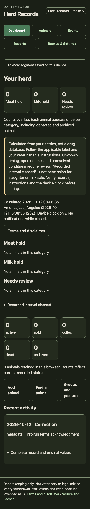

# Manley Farms Herd Records

Free cattle records that work offline after the first verified download. Keep animal identity, parentage, calving, weights, breeding, treatments and departures, with separate recorded meat and milk withdrawal holds.

**Public beta 1.3.0-beta.1, schema 1.** Veterinarian/BQA clinical review and the multi-device field pilot have not been completed. This is not certified or endorsed by BQA, FDA, USDA or any authority. Results need independent checking. The terms are not lawyer-reviewed; Manley Farms is a Washington business, not a law firm.

[Open Herd Records](https://herd.manleyfarms.com/) · [Source repository](https://github.com/workmanl/manley-farms-herd-records) · [Release archives](https://github.com/workmanl/manley-farms-herd-records/releases)

This checkout prepares the release locally. Publication and deployment are separate handoff steps; the live link above is the intended public destination.



The screenshot shows an empty test dataset from an earlier development phase, not a clinical review or a current beta browser check.

## Free forever

The official tool is free forever: no account, subscription, paid tier, trial or herd-size charge. Donations are optional and never gate any function. [Support Manley Farms](https://buy.stripe.com/bJefZg26S8Ry99qePt8Ra03). This existing donation link is also used on the Manley Farms Tools page. AGPL permits charging for compliant forks; the official pledge does not remove that freedom.

## Launch, install and go offline

1. Open the app while connected, read the terms and acknowledge the limits. Wait for **Ready offline** before leaving signal.
2. On iPhone/iPad Safari use Share > Add to Home Screen. On Android Chrome use Install app or Add to Home screen. On desktop Chrome/Edge use the install control; Mac Safari may offer Add to Dock. Installation is optional.
3. Reopen without signal and verify your records and a saved backup. Browser and installed contexts may hold separate databases. See the [offline field guide](app/help.html).

Entry, history, exports and report preparation work offline once the shell is ready. First use and update downloads require a connection. Notifications while closed are not promised. Do not activate an update over unsaved forms or calf drafts. Schema-changing updates require a newly saved and verified backup. Recovery preserves records and offers exports; never clear storage to fix an update.

## Operation fit and browser support

Cow-calf records include twins, calving assistance and linked birth weights. Stocker/backgrounder records include groups, pasture changes, actual weights, average daily gain and batch treatment. Small seedstock operations get basic parentage and lifetime history. No registry/genetic evaluation, drug selection, dose advice, cost-of-gain model or complete dairy system is included. One operation lives in each browser profile, with no software head-count gate.

Core browser use targets current Safari on iPhone/iPad and Mac, Chrome on Android and desktop, Edge and Firefox. Installation support varies. These are support targets, not proof that every device passed. Physical-device performance, assistive technology, sunlight and multi-device field acceptance remain gates. The [Phase 6 report](docs/phase6-report.md) separates Node benchmarks from browser evidence and contains the device checklist.

## Privacy and storage limits

Herd fields stay in IndexedDB on your device. No account, telemetry, record uploads, cloud backup or automatic sync is provided. Ordinary page and asset requests go to the web host. There is no email signup on this app origin. Herd records are never sent. Optional source and donation links navigate only when chosen and include no herd context.

Records are not encrypted by the app. Device/profile access and other scripts on the same website origin can expose them. Different browsers, profiles and installed contexts may hold separate copies. Clearing site data, private browsing, eviction, device loss, storage limits or software errors can destroy records. Persistent storage can reduce eviction risk, but does not guarantee retention. Manley Farms has no recovery copy.

## Withdrawal and responsibility

This is recordkeeping, not veterinary, legal or regulatory advice. There is no drug database. Supply separate meat and milk instructions from the actual product label or your veterinarian. You remain responsible for withdrawal compliance, accurate entries and following those instructions.

The dashboard shows Meat hold, Milk hold and Needs review. Counts overlap and retain sold/archived animals. Repeated administrations and overlapping treatments control recorded release times. Unknowns, date-only administration, open courses, prohibited use and unresolved conditions require review. Blank is never zero; explicit zero requires instruction confirmation. A backward clock change remains flagged until audited review.

**Recorded interval elapsed never means safe for slaughter or milk.** A countdown is arithmetic from your inputs and device time, not clearance, residue testing or compliance certification. Inspect contributing treatments and independently verify the actual history before decisions. Corrections retain prior values and reasons; departure acknowledgment never authorizes slaughter or milk sale.

The app is provided as is, without warranty to the extent permitted by law. You assume the described risks; liability is limited subject to mandatory rights. Read the complete [Terms of Use and Disclaimer](app/terms.txt) and [AGPL warranty/liability provisions](LICENSE).

## Back up, verify and restore

1. In **Backup & Settings**, download JSON and save it outside the browser. A requested download does not prove a file was saved. Confirm saved only after saving it.
2. Select the saved file under **Verify a backup**. It checks structure, checksum, counts, IDs and references without changing live records. Checksums detect alteration, not authenticity.
3. Choose Replace or Merge and preview. Cancellation and preview make no record changes. Replacement requires downloading and verifying the exact current dataset first.
4. Merge skips identical records and requires explicit decisions for every conflict. No timestamp wins automatically. Clinical corrections require a reason and hold review. A failed transaction or stale preview preserves committed data.
5. Keep copies in two places and rehearse restoration in a spare profile. Back up before changing devices, clearing storage or installing schema changes. Reminders default to seven days when unbacked changes exist.

Imported acknowledgment receipts remain history but do not establish a new operator’s acceptance. Recovery exports are labeled separately from verified backup envelopes. JSON is the authoritative lossless restoration format.

## Switching away and reports

In **Reports**, follow the bundled switching guide. Export all 14 CSV tables, scope manifest and dictionary, plus verified JSON and printable reports. Retain stable IDs and foreign keys; map animals before dependent events in the destination system and reconcile parentage, weights and withdrawal instructions. CSV exports use quoted UTF-8 and documented reversible formula protection. Filtered exports are not complete backups.

CSV import supports mapping, preview, row errors and explicit conflicts before one confirmed commit. Treatment logs, calving books and animal cards can be printed or saved as PDF. These help organize records for review; they do not certify BQA compliance. Keep the complete runnable source archive so you can host elsewhere even if the original site becomes unavailable. Rehearse restoration yearly; no universal third-party importer is promised.

## Local hosting and data documentation

No runtime package installation or build step is required. Serve the complete `app/` directory over HTTPS or localhost:

```sh
node scripts/serve.mjs
```

Open <http://127.0.0.1:8765/>. Keep the same origin, port and browser profile to access the same records. Opening with `file://` is unsupported. For a fork’s different directory path, run `HERD_BASE_PATH=/your/path/ node scripts/build-pwa.mjs` and align the host directory with the manifest scope. Regenerate the inventory after any app asset edit.

[Data dictionary](docs/data-dictionary.md) · [Architecture](docs/architecture.md) · [Synthetic fixture](tests/fixtures/sample-herd.json)

## Tests and contributions

Node.js 22 or newer is recommended. Development-only dependencies are fake-indexeddb and jsdom. Neither ships in the app.

```sh
npm ci
npm test
npm run test:scale
```

The standard suite covers data integrity, atomic rollback, migrations/recovery, withdrawals, JSON/CSV round trips, rendered controls, PWA coordination, shell hashes and public release content. Scale tests are separate Node proxies with 10,000 lifetime animals, 500 active and 250,000 events. They do not establish phone performance. See [Phase 7 evidence and remaining gates](docs/phase7-report.md).

Read [CONTRIBUTING](CONTRIBUTING.md) and the [Code of Conduct](CODE_OF_CONDUCT.md). Report ordinary problems through [GitHub issues](https://github.com/workmanl/manley-farms-herd-records/issues), using synthetic or redacted examples. Never attach identifiable herd records. For vulnerabilities use the private route in [SECURITY](SECURITY.md). No proprietary relicensing CLA is required.

## Release policy

Run the tests, regenerate and verify the shell inventory, then package locally:

```sh
node scripts/build-pwa.mjs
npm test
node scripts/release.mjs
```

The packager verifies inventory hashes and writes static and source ZIPs in `dist/`, each with its own SHA256SUMS file plus a combined `SHA256SUMS`. The static archive contains the complete unchanged `app/` directory. Extract it and copy its contents to the hosting directory. The source archive excludes dependencies, output, repository metadata, local tooling and scale artifacts.

Clinical review, the multi-device field pilot, lawyer review of terms, staged browser/print/offline/update checks and restoration on another device/origin remain pre-launch gates. Resolve every data-loss or false-clearance defect before release. Replace `https://github.com/workmanl/manley-farms-herd-records` after repository creation, regenerate inventory, rerun tests and repackage so archives match the published source. Review, tag and publish matching source/static archives with schema compatibility in the changelog. Deploy only the tagged artifact, retain compatible prior assets, then verify the live version, offline readiness, exports and isolated cache scope. Website changes must return through the source repository.

## License and source

Copyright (C) 2026 Scott Manley. Original code and covered project documentation are **AGPL-3.0-only**. The complete unmodified license is in [LICENSE](LICENSE) and `app/LICENSE`. Modified network-interactive versions must offer corresponding source as the license requires. Your own herd records remain yours. Contributor Covenant text carries its own attribution below. Locally bundled DM Sans and Inter variable Latin fonts are licensed under SIL OFL 1.1. See [third-party licenses](THIRD_PARTY.md) and the original licenses in app/fonts/. No remote fonts or runtime dependencies are used.

### Dashboard screenshots and review

The 1.1 dashboard starts at Your herd with counts, seven guided quick actions, Today, animal search and recent activity. New users get three welcome steps and optional isolated sample cattle. Screenshot capture is pending Claude’s local browser review: capture populated and empty dashboards at 390px and 1280px, plus the sunlight theme and a guided treatment. Existing phase screenshots document previous versions.

## Move to the new address

Open [herd.manleyfarms.com](https://herd.manleyfarms.com/). If you used the old address, save a copy there, then choose **Restore your saved copy** here. Records do not move by themselves. The old address stays read-only so new records go in one place. It never removes records on its own.

`npm run release` builds `dist/herd-origin/` and `dist/moved/`, their ZIP files, the source ZIP and `dist/SHA256SUMS`. Upload the contents of each folder at its target path. The new-origin folder includes the files from `hosting/herd-origin/`.

The deploy settings live in `app/lib/deploy-config.js`. For a custom host, set `HERD_BASE_PATH` and `HERD_ORIGIN` when running `npm run pwa:inventory`; this writes the one config and generates matching metadata, manifest and precache. The moved artifact keeps the old worker path and scope.

See [the origin move report](docs/origin-move-report.md) for the deploy order and the live gate. Do not redirect the old app path at the host.
